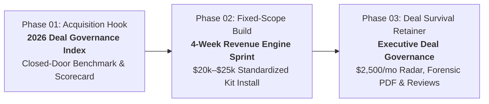

# The Sales Bench — Project Status & System Documentation

**Document Version:** 1.0.0  
**Last Updated:** October 27, 2026  
**Founder & Managing Principal:** Scott Carpentier  
**Public Repository:** [https://github.com/ScottRepository/thesalesbench-website](https://github.com/ScottRepository/thesalesbench-website)  
**Live Production URL:** [https://scottrepository.github.io/thesalesbench-website/](https://scottrepository.github.io/thesalesbench-website/)  

---

## 1. Project Overview & Tech Stack

### 1.1 Strategic Mission & Positioning
**The Sales Bench** has evolved from traditional sales advisory and custom development into an authoritative **Enterprise Revenue Architecture & Deal Governance** practice. 

The firm serves high-growth B2B SaaS companies by installing standardized, autonomous MEDDPICC deal-governance workflows and post-call CRM intelligence directly inside the client's existing technology stack.

* **Ideal Customer Profile (ICP):**
  * **Revenue Scale:** $5M to $30M Annual Recurring Revenue (ARR).
  * **Average Contract Value (ACV):** $30,000 to $150,000+ (complex, multi-stakeholder enterprise deals).
  * **Sales Team Size:** 5 to 20 quota-carrying Account Executives (AEs).
  * **Target Executive Personas:** Chief Revenue Officer (CRO), VP of Sales, Founder/CEO, Head of RevOps.
* **Core Economic Value Proposition:**
  * **Stop Deal Slippage:** Eliminate late-stage pipeline slippage where 25%–35% of forecast commitments roll over; rescuing a single $50k ACV deal delivers a 3x+ ROI on annual governance fees.
  * **Recover Selling Capacity:** Automate 45–60 minutes of daily administrative CRM drag per rep. Across a 10-AE team, this recovers **40 hours/week**—the equivalent of **1 full-time quota-carrying AE ($120k–$160k annual value)** at zero added headcount.
  * **Zero InfoSec & Procurement Friction (BYOK Model):** "Bring Your Own Key" architecture deploys inside the client's existing CRM perimeter (HubSpot / Salesforce) and AI tenants (OpenAI / Azure / Anthropic). Zero customer PII or raw deal data is stored on third-party servers, bypassing 3–6 month SOC 2 vendor reviews.
  * **Operational Division of Labor:** *"We own the brain; you own the plumbing."* The Sales Bench delivers battle-tested governance logic, MEDDPICC audit engines, and executive inspection protocols, while the client's RevOps team maintains core CRM schema.

---

### 1.2 Technology Stack & Architecture

| Layer | Technology / Implementation | Strategic Advantage |
| :--- | :--- | :--- |
| **Hosting & Deployment** | GitHub Pages (`origin/main`) | 99.99% uptime, zero hosting overhead, SSL automated, edge CDN delivery. |
| **Front-End Architecture** | Single-File Self-Contained (`index.html`) | Zero external CSS dependencies, immune to CDN downtime, instantaneous page loads, zero build-step fragility. |
| **Design System** | Scalematters × Leanscale High-Contrast Enterprise Theme | Technical obsidian (`#070b14`), carbon slate (`#0f172a`), emerald accents (`#10b981`), electric cyan (`#06b6d4`), and clean canvas (`#f8fafc`). |
| **Interactive Logic** | Native Vanilla JavaScript (ES6+) | Tabbed sprint engine, live benchmark diagnostic calculator, dynamic scorecard modal generator. |
| **Lead Capture & CRM** | HubSpot Forms API v2 (`portal: 342958738`, `form: de5aa2ee-c4fc-4f04-8b6b-563c3bfb9fa3`) | Enterprise lead routing, automated notification triggers, zero raw email exposure to scrapers. |
| **Deployment Scripting** | Custom Bash CLI (`push.sh`) | Atomic sync from ChromeOS Linux workspace to local Downloads and remote GitHub repository. |

---

## 2. Completed Milestones & Configurations

### 2.1 Strategic Architecture & Value Ladder
We transformed the business model into a high-margin, scalable **3-Phase Commercial Value Ladder**:



1. **Phase 01 // Acquisition Hook: The 2026 Enterprise Deal Governance & Pipeline Leakage Index**
   * High-status peer benchmarking initiative for 15 qualifying B2B SaaS revenue leaders.
   * Closed-door 20-minute diagnostic evaluating pipeline reality across 5 critical enterprise dimensions.
   * Generates a confidential **1-Page Pipeline Leakage & Deal Governance Scorecard** identifying hidden revenue bleed.
2. **Phase 02 // Fixed-Scope Build: The 4-Week "Enterprise Revenue Engine" Sprint ($20k–$25k Fixed Fee)**
   * Rapid installation of the standardized **Revenue Infrastructure Kit** inside the client's CRM/AI perimeter:
     * *Component 01:* MEDDPICC Rigor & Autonomous Audit Engine.
     * *Component 02:* Post-Call CRM Synthesis & Action-Item Drafter.
     * *Component 03:* Standardized Digital Deal Room & Mutual Action Plan (MAP) Template.
     * *Component 04:* 3-Page RevOps Runbook + 14-Day Hypercare Window.
3. **Phase 03 // Retained Deal Survival: The Executive Deal Governance Retainer ($2,500/Month Recurring)**
   * **Weekly Autonomous Deal Health Radar:** Slack/Email slippage alerts flagging deals advancing without Economic Buyer access or verified Paper Process milestones.
   * **Monthly 10-Page Revenue Leakage & Cohort Forensic Report (PDF):** In-depth audit of stage-duration creep, champion validation gaps, and forecasted vs. actual slippage.
   * **Live 60-Minute Executive Strategic Deal Review (The Anti-Fluff Protocol):** Monthly closed-door inspection of the Top 5 enterprise opportunities with CRO and CEO, utilizing structured forensic challenge questions.
   * **Weekly Automated API Heartbeat:** Automated monitoring ensuring webhook and AI prompt integrity.

---

### 2.2 Website Sections Implemented

The production website (`index.html`) contains **2,553 lines of clean, structured code** featuring:

* **Enterprise Header & Sticky Navigation:** High-contrast logo lockup with navigation anchors to `#value-ladder`, `#sprint-engine`, `#governance-retainer`, `#byok-security`, `#services`, `#about`, and `#diagnostic`.
* **Architectural Grid Hero Section:** High-authority headline, enterprise badge bar (`$5M–$30M ARR`, `$30k–$150k+ ACV`, `5–20 AEs`), CTA button to participate in the benchmark, and an interactive system console display.
* **Economic Leverage Bar:** Highlights the 4 quantitative anchors: `25%–35% Slippage Eliminated`, `40 hrs/wk Recovered (1 FTE)`, `1 Saved Deal = 3x ROI`, and `0 Months InfoSec Delay`.
* **3-Phase Value Ladder Section:** Visual roadmap breaking down the closed-door benchmark, the 4-week sprint, and the ongoing governance retainer.
* **Interactive 4-Tab Revenue Infrastructure Engine:**
  * *Tab 1: MEDDPICC Rigor Engine:* Inspects qualification criteria with automated red-flag alerts.
  * *Tab 2: Post-Call CRM Drafter:* Translates raw customer conversations into CRM fields and mutual follow-up emails within 120 seconds.
  * *Tab 3: Digital Deal Room & MAP:* External buyer-facing portal standardizing legal, security, and procurement steps.
  * *Tab 4: 4-Week Sprint Schedule:* Weekly breakdown of Discovery, CRM Build, Logic Deployment, and Enablement/Hypercare.
* **Executive Deal Governance & The Anti-Fluff Protocol Section:** Comprehensive breakdown of the Weekly Radar, Monthly 10-Page Forensic PDF, and the exact interrogation scripts used to inspect deals with executive teams.
* **CISO-Ready BYOK Security Architecture Section:** Side-by-side technical boundary diagram comparing what stays 100% inside client boundary vs. anonymized execution telemetry.
* **Interactive Diagnostic & Pipeline Leakage Scorecard:**
  * Real-time 5-question enterprise assessment (Forecast Slippage, Economic Buyer Access, Paper Process Gaps, Rep Admin Drag, Stage-Gate Enforcement).
  * Dynamic client-side scoring logic calculating annual revenue at risk and hours lost.
  * Scorecard Preview Modal displaying calculated metrics alongside the embedded HubSpot consultation form.

---

## 3. Current State of the Codebase

### 3.1 Local Directory Structure
```
/home/scottcarpentier/
├── thesalesbench-website/                 # Main Git repository (cloned from GitHub)
│   ├── index.html                         # Production single-file marketing application (2,553 lines)
│   ├── PROJECT_STATUS.md                  # Comprehensive project status & documentation (this file)
│   ├── README.md                          # Repository summary & asset guide
│   └── .git/                              # Git metadata pointing to origin/main
├── Downloads/
│   └── The_Sales_Bench_Website.html       # Mirrored copy for local offline browser inspection
└── push.sh                                # Automated sync & deployment bash script
```

### 3.2 Git & Deployment Script (`push.sh`)
```bash
#!/bin/bash
set -e
cp /home/scottcarpentier/thesalesbench-website/index.html /home/scottcarpentier/Downloads/The_Sales_Bench_Website.html
cd /home/scottcarpentier/thesalesbench-website
git add index.html PROJECT_STATUS.md
git commit -m "Update site architecture and project status documentation" || true
git push origin main
echo "Successfully pushed to GitHub Pages and synced Downloads copy!"
```

---

## 4. Top Priorities & Roadmap

### Priority 1: Immediate Execution (Week 1)
* [ ] **Publish Latest Commit:** Run `bash push.sh` in the terminal to deploy `index.html` and `PROJECT_STATUS.md` to GitHub Pages.
* [ ] **Verify Live Production Site:** Confirm that all tabs, modals, and HubSpot form embeds function seamlessly at `https://scottrepository.github.io/thesalesbench-website/`.
* [ ] **Configure Custom Domain (Optional):** Map `thesalesbench.com` (or preferred domain) via GitHub Pages DNS settings (CNAME + apex A-records).

### Priority 2: Benchmark Cohort Outreach (Weeks 2–3)
* [ ] **Target List Assembly:** Curate a focused list of 40–50 B2B SaaS CROs and Heads of RevOps within the $5M–$30M ARR tier.
* [ ] **Execute Closed-Door Invitation Campaign:** Launch personalized, low-friction outreach inviting leaders to participate in the *2026 Enterprise Deal Governance & Pipeline Leakage Index*.
* [ ] **Deliver Private Scorecards:** Conduct 20-minute diagnostic interviews and generate 1-page customized leak assessments to convert benchmark participants into 4-Week Sprint engagements ($20k–$25k).

### Priority 3: Sprint Delivery Playbook & Kit Standardization (Weeks 4–6)
* [ ] **MEDDPICC Property Packets:** Finalize standard import packages (JSON / CSV schema) for HubSpot and Salesforce custom deal properties.
* [ ] **Prompt Engineering Vault:** Document tested prompt templates for meeting transcription synthesis, MEDDPICC gap detection, and executive follow-up drafting.
* [ ] **Standardized SOW & Master Services Agreement (MSA):** Formalize the fixed-fee $20k–$25k sprint contract with standard 30-day delivery terms.

### Priority 4: Autonomous Productization (Months 2–4)
* [ ] **Autonomous Slack Governance Bot:** Productize the Weekly Deal Health Radar as an installable internal Slack bot connecting directly to client CRM webhooks.
* [ ] **Automated Forensic Report Generator:** Build an automated pipeline script that ingests anonymized CRM stage histories and compiles the 10-page Monthly Forensic PDF.
* [ ] **De-Identified Benchmark Platform:** Aggregated telemetry from retained clients will power the foundational dataset for The Sales Bench's proprietary SaaS platform.
